# n8n local — mode queue + Redis HA + monitoring

Stack : n8n (main, workers, webhook) · Postgres · Redis HA (3 nœuds + 3 Sentinel + HAProxy) · nginx (HTTPS mkcert) · Prometheus · Grafana · Loki · Alloy.

Même `docker-compose.yml` sur deux moteurs, pour comparer leur comportement :

| Machine | Moteur | Mode |
|---|---|---|
| MacBook (macOS) | **Docker Desktop** | rootful (dans la VM Docker Desktop) |
| PC Windows (WSL2) | **Podman** | rootless |

## Architecture

<picture>
  <source media="(prefers-color-scheme: dark)" srcset="docs/architecture-dark.svg">
  
</picture>

[**Version interactive**](https://echchouik.github.io/n8n-local-stack/architecture.html) (zoom, recherche, focus sur un composant, export).
Source du diagramme : [`docs/architecture.json`](docs/architecture.json) (format [Archify](https://github.com/tt-a1i/archify)).

## Prérequis

| | macOS — Docker Desktop | WSL2 (Ubuntu) — Podman |
|---|---|---|
| Moteur | Docker Desktop installé et démarré | `sudo apt install podman` (backend réseau netavark requis) + `systemctl --user enable --now podman.socket` (systemd activé dans `/etc/wsl.conf`) |
| Compose | `docker compose` (inclus dans Docker Desktop) | binaire `docker-compose` v2 dans le PATH, appelé par `podman compose` |
| Certificats | `brew install mkcert` | `sudo apt install mkcert libnss3-tools` |

`podman compose` délègue à `docker-compose` : c'est voulu. `podman-compose` (Python) ne gère pas
`depends_on.condition` / `restart: true`. Avantage pour la comparaison : même outil compose des deux côtés,
toute différence vient du moteur.

## Installation

```bash
git clone <repo> && cd n8n-docker     # WSL : dans ~ (pas /mnt/c)
./scripts/setup.sh                    # .env + certificats + socket (moteur auto : docker sur macOS, podman sur Linux)

docker compose up -d --remove-orphans   # macOS
podman compose up -d --remove-orphans   # WSL
```

Forcer un moteur : `ENGINE=docker ./scripts/setup.sh` (ou `ENGINE=podman`).

- n8n : https://n8n.localhost:8443
- Grafana : https://n8n.localhost:8443/grafana/ (admin / `GRAFANA_ADMIN_PASSWORD` du `.env`)
- Prometheus : `/prometheus/` · Alloy : `/alloy/`

Scaler les workers : `docker compose up -d --scale n8n-worker=3` (ou `podman compose ...`)

## Redis en haute disponibilité (Sentinel + HAProxy)

n8n ne sait pas parler à Sentinel (seulement à un Redis simple ou à un Redis Cluster). On lui donne donc
une adresse unique, `haproxy:6379`, et c'est HAProxy qui suit le master :

```
n8n main / workers / webhook ──> haproxy:6379 ──> redis-1 | redis-2 | redis-3
                                     │              (route vers celui qui répond role:master)
                                     │
               sentinel-1 / sentinel-2 / sentinel-3 : surveillent le master, élisent un remplaçant (quorum 2)
```

| Brique | Rôle |
|---|---|
| `redis-1..3` | 1 master + 2 replicas. `redis-1` est master au **premier** démarrage seulement ; ensuite c'est Sentinel qui décide |
| `sentinel-1..3` | Déclarent le master mort après 5s sans réponse (`down-after-milliseconds`), puis promeuvent un replica si 2 sentinelles sur 3 sont d'accord |
| `haproxy` | Interroge les 3 nœuds chaque seconde (`AUTH` / `PING` / `INFO replication` → `role:master`) et coupe les connexions vers un ancien master pour forcer n8n à se reconnecter |

Fichiers :

| Fichier | Contenu |
|---|---|
| `redis/redis-node.sh` | Génère `/data/redis.conf` au 1er démarrage ; à chaque démarrage, demande aux sentinelles qui est master et démarre en replica si ce n'est pas lui |
| `redis/sentinel.sh` | Génère `/data/sentinel.conf` au 1er démarrage (noms DNS au lieu des IP, mot de passe, quorum) |
| `haproxy/haproxy.cfg` | Check `role:master`, résolution DNS dynamique, métriques Prometheus sur `:8404/metrics` |
| `scripts/test-failover.sh` | Arrête le master, mesure la bascule, redémarre l'ancien master et vérifie qu'il revient replica |

Tester une panne :

```bash
./scripts/test-failover.sh              # bascule complète puis retour de l'ancien master
KEEP_DOWN=1 ./scripts/test-failover.sh  # laisse l'ancien master arrêté (pour observer les alertes)
```

Résultat attendu (mesuré sur banc de test) : nouveau master élu en ~7s, HAProxy rebasculé en ~8s,
aucune écriture acquittée perdue. Pendant ces ~8s, les commandes Redis de n8n échouent puis sont relancées ;
`QUEUE_BULL_REDIS_TIMEOUT_THRESHOLD=30000` évite que n8n s'arrête avant la fin de la bascule.

Commandes utiles :

```bash
# master courant selon Sentinel
docker compose exec sentinel-1 redis-cli -p 26379 sentinel get-master-addr-by-name mymaster
# rôle de chaque nœud
for n in redis-1 redis-2 redis-3; do docker compose exec $n redis-cli role | head -1; done
# état des serveurs vu par HAProxy
docker compose exec haproxy wget -qO- http://127.0.0.1:8404/metrics | grep 'haproxy_server_status{proxy="redis_master".*state="UP"'
```

Points à connaître :

- **L'état est dans les volumes** (`redis_N_data`, `sentinel_N_data`) : Sentinel y réécrit le rôle de chaque nœud.
  Repartir de zéro (redis-1 master) : `docker compose down` puis supprimer ces 6 volumes.
- Un ancien master qui revient ne repasse **pas** master : il démarre directement en replica du master actuel
  (sinon il y aurait brièvement 2 masters et HAProxy enverrait des écritures aux deux).
- Sentinel doit pouvoir résoudre le nom du master qu'il surveille au démarrage. Si une sentinelle redémarre
  alors que ce master est arrêté, elle peut boucler en redémarrage le temps qu'il revienne ou qu'une autre
  sentinelle le remplace.
- Ce n'est pas une HA « réseau » : en cas de coupure réseau partielle (pas simulable ici simplement),
  un ancien master isolé peut accepter des écritures qui seront perdues. `min-replicas-to-write` limite ce risque en production.
- Migration depuis l'ancien Redis unique : le service `redis` disparaît. `--remove-orphans` supprime son conteneur ;
  le volume `redis_data` (file en cours) n'est pas repris et peut être supprimé : `docker volume rm <projet>_redis_data`.

## Monitoring et logs

Tout est provisionné au démarrage de Grafana (aucune config manuelle) :

| Fichier | Rôle |
|---|---|
| `grafana/provisioning/datasources/datasources.yml` | Sources Prometheus (uid `prometheus`) et Loki (uid `loki`) |
| `grafana/provisioning/dashboards/dashboards.yml` | Charge `grafana/dashboards/` ; un sous-dossier = un dossier Grafana |
| `grafana/dashboards/n8n/` | n8n : file Redis, exécutions, ressources par instance, logs |
| `grafana/dashboards/infrastructure/` | PostgreSQL, Redis (par nœud), **Redis HA** (master, Sentinel, HAProxy, bascules), nginx |
| `grafana/dashboards/logs/` | Explorateur de logs : filtres service / niveau / recherche regex |
| `grafana/dashboards/monitoring/` | Santé de Prometheus, Loki, Alloy (cibles, ingestion, pertes) |

Redis : un seul `redis-exporter` en mode multi-cibles interroge les 3 nœuds (job `redis`) et les 3 sentinelles
(job `redis-sentinel`) ; le label `instance` vaut `redis-1`, `sentinel-2`, etc. HAProxy expose ses propres métriques (job `haproxy`).

Alertes Redis HA (Telegram, groupe `redis-ha`) :

| Alerte | Déclenchement |
|---|---|
| Service backend DOWN | un nœud ou une sentinelle injoignable (5s) |
| Redis — nombre de masters anormal | 0 ou ≥ 2 masters pendant 20s |
| HAProxy — aucun master Redis | HAProxy ne route vers aucun nœud pendant 15s : n8n n'a plus de file |
| Sentinel — quorum perdu | moins de 2 sentinelles actives |
| Redis — failover effectué | ligne `+switch-master` dans les logs Sentinel (avec ancien → nouveau master) |

Chaîne de logs : stdout/stderr des conteneurs → Alloy (socket du moteur) → Loki → Grafana.
Labels disponibles : `service`, `service_name`, `container`, `project`, `stream`, plus `method` / `status` pour nginx.
Loki ajoute `detected_level` (error, warn, info...) à chaque ligne.

Modifier un dashboard : l'éditer dans Grafana, puis *Export > JSON* et remplacer le fichier dans `grafana/dashboards/`
(sinon la modification est perdue si le fichier change).

## Ce qui diffère entre les deux moteurs

| Sujet | Docker Desktop (macOS) | Podman rootless (WSL) |
|---|---|---|
| Privilèges | daemon root dans une VM | pas de daemon, conteneurs sous ton UID |
| Socket API (`CONTAINER_SOCKET`) | `/var/run/docker.sock` | `/run/user/<uid>/podman/podman.sock` (activé par systemd) |
| Réseau / DNS | bridge + DNS embarqué Docker | netavark + aardvark-dns |
| Résolveur vu par HAProxy (`parse-resolv-conf`) | `127.0.0.11` | passerelle du réseau (aardvark-dns) |
| Ports < 1024 | autorisés | refusés (d'où 8080/8443 partout) |
| `security_opt: label=disable` (Alloy) | ignoré (pas de SELinux) | utile seulement si SELinux est actif |
| UID des volumes | root | mappés via user namespace |

## Notes

- `.env` et `nginx/certs/*` (clé privée) ne sont jamais commités : chaque machine génère les siens via `setup.sh`.
- Un `.env` existant avec l'ancienne variable `PODMAN_SOCKET` est migré automatiquement vers `CONTAINER_SOCKET` en relançant `setup.sh`.
- WSL : le navigateur est sous Windows ; lancer `setup.sh` avec `CAROOT` pointant vers la CA mkcert installée côté Windows.
- Safari / curl sur macOS : ajouter `127.0.0.1 n8n.localhost` dans `/etc/hosts`.
